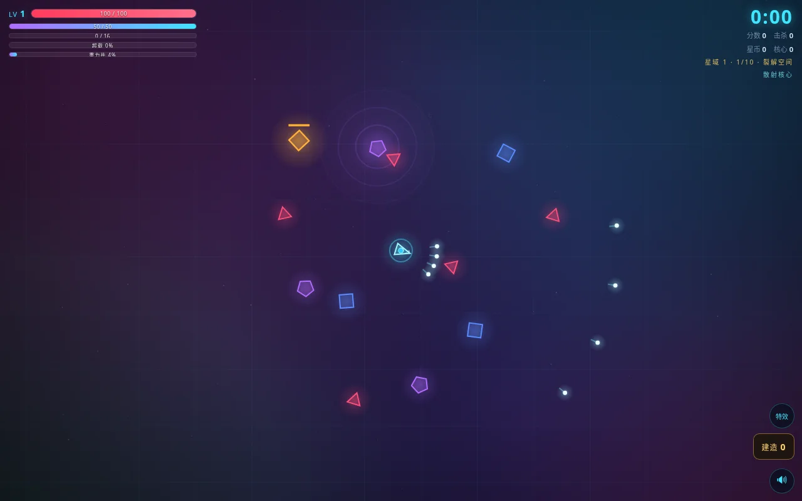

# 星域幸存者 · Starfield Survivor

[](https://github.com/xiiiyuee/Game/actions/workflows/ci.yml)
[](https://github.com/xiiiyuee/Game/actions/workflows/pages.yml)

单文件 Canvas 弹幕肉鸽。在无尽星域中自动开火、主动改弹幕、布防城墙，支持单机与 WebRTC 联机合作。



## 在线试玩

部署后地址：<https://xiiiyuee.github.io/Game/>

首次使用需在仓库 **Settings → Pages → Source** 选择 **GitHub Actions**，之后推送到 `main` 会自动构建并发布。

## 玩法要点

- **主动技能**：开局三选一——相位冲刺（无敌穿越 + 残影补射）、重力井（聚怪聚弹 + 内爆）、擦弹回流（吸收掠过的敌弹，换护盾、增伤与能量）。
- **能量循环**：能量靠被动回复与命中敌人积累，满能量施放；冷却期间仍可继续蓄能，即「射击换能量」。
- **局内成长**：升级卡提供武器进化、诅咒、技能增幅与防线强化；每级可刷新一次卡牌。
- **塔防防线**：消耗核心建造炮塔 / 缓速场 / 城墙，可升级、可手动修复，脱战后自动修复。
- **无尽远航**：每章 10 波，Boss 后进入下一星域，难度与词缀持续攀升。
- **联机合作**：房主权威模拟，客机表现；支持个人商店、交易与倒地救援。

## 操作

| 按键 | 功能 |
| --- | --- |
| `WASD` / 方向键 | 移动 |
| `空格` / `Shift` | 冲刺 |
| `Q` | 主动技能 |
| `E` | 超载 |
| `B` | 建造模式 |
| `F` | 防线升级 / 修复 |
| `R` | 刷新升级卡 |
| `1` / `2` / `3` | 选择升级卡 |
| `Esc` | 暂停 |

手机端使用右下角触屏按钮。

## 本地开发

项目零运行时依赖，需要 Node.js 18+。

```bash
cd star-survivor
npm test     # 构建 + 静态检查
npm run dev  # 构建并启动本地预览 http://localhost:4173
```

构建产物位于 `star-survivor/dist/index.html`，可直接双击打开，也可部署到任意静态托管。

## 仓库结构

```
Game/
├─ README.md
├─ LICENSE
├─ .gitignore
├─ .github/workflows/
│  ├─ ci.yml                 # push / PR 构建与检查
│  └─ pages.yml              # 构建并发布 GitHub Pages
└─ star-survivor/
   ├─ package.json
   ├─ scripts/               # build / check / serve
   ├─ src/
   │  ├─ index.template.html
   │  ├─ manifest.json       # 源码拼接顺序
   │  ├─ js/                 # 24 个功能分区
   │  └─ styles/             # 14 个样式分区
   ├─ tests/                 # 无头 Chrome 回归脚本
   └─ docs/                  # 截图与开发交接文档
```

## 构建原理

`src/manifest.json` 定义 JS / CSS 的拼接顺序，`scripts/build.mjs` 读取模板并注入样式与脚本，最终生成一个自包含的 `dist/index.html`。不使用打包器，保持「单文件即玩」的定位。

`scripts/check.mjs` 会校验 manifest 完整性、每个分区的语法、产物占位符与统一的 IIFE 包装。

## 测试

`star-survivor/tests/` 存放无头 Chrome 回归脚本，覆盖经验、稀有度、防线、联机、主动技能与冒烟测试。脚本依赖本机 `puppeteer-core` 与 Chrome，因此不纳入 CI，按需手动运行：

```bash
node star-survivor/tests/prep.mjs   # 生成 /tmp/qa/sstest/index.html
```

## 许可

[MIT](LICENSE)
